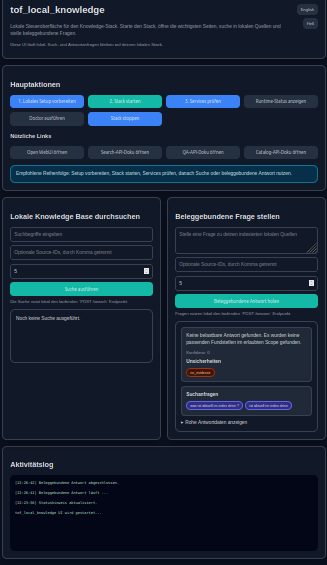

# tof_local_knowledge

<p align="center">
  
</p>

**Find answers in local documents — with evidence you can inspect.**

Local Knowledge helps you index documents, search their contents, and generate evidence-grounded answers. It is designed for people and teams that need **traceable sources rather than unverified free-form answers**.

**Get started:** [First run and safe demo](START_HERE.md) · [German README](README_DE.md) · [ToF Systems overview](https://github.com/IMaugrenI/tof-showcase)

**Source distribution candidate (B8/K8):** Existing Windows/Linux/macOS starters can now be packaged from a committed Git snapshot using the manual **Source distribution candidate** workflow or `python scripts/build_source_candidate.py --output-dir dist`. The ZIP includes [offline instructions](docs/RELEASE_PACKAGE.md) and a SHA-256 checksum. **Not an approved release or native installer; target-system acceptance comes after development.**

## See a grounded answer

The public demo uses synthetic documents from `demo/source_1/`. The screenshot below is a real local UI view of a retrieved result, an answer with citations, and the documents used.



[Demo evidence and screenshots](docs/03_demo_evidence_screenshots.md) · [No-evidence example](assets/screenshots/knowledge-06-no-evidence-contract-number.png)

**Scope:** this repository is the independent **Ground** tool. It is not a cloud sync service, general AI builder, or an automatic source of truth. Retrieved evidence and missing evidence must remain distinguishable. Its outputs can inform other tools, but integration is not implied.

## New in the K1 development branch

A new **Sources & Index** section in the existing local browser UI summarizes registered sources, indexed documents, pending/failed/missing states and the most recent scan. Choosing a source fills the existing search and question filters. This is a **local single-user overview**, not a new authentication or multi-user authorization mechanism.

The scan now preserves successful unchanged documents, identifies changed and missing files, and avoids falsely reconciling unvisited files when scanning is incomplete. Search excludes non-current indexed documents; failed extractions preserve earlier segments for recovery without serving them as current evidence.

The displayed QA score is explicitly described as an *uncalibrated heuristic*, not the probability an answer is true. See the [K1 development pull request](https://github.com/IMaugrenI/tof_local_knowledge/pull/16) and [code-status document](docs/10_build_status.md) for limitations.

## K2: explicitly index the configured source

The existing browser control page now has an **Index configured source** action. It only scans the source already mounted read-only from `LOCAL_SOURCE_ROOT_1` (`/sources/source_1` inside existing services), using `LOCAL_SOURCE_ID_1` or the default `demo_source_1`.

A click scans up to 100 files and extracts up to eight new, changed or retry-eligible documents. The UI reports indexed documents and failures; further batches can be started manually. **No background scanning, new service, multi-user authentication or public network exposure is added.** This is a local single-user workflow.

## K4 — Inspect the cited excerpt

Search hits and QA evidence references now offer **View excerpt**. The existing local browser UI retrieves the exact segment by its ID and displays the cataloged source, document, citation and up to 2,000 characters of the source excerpt. Only currently indexed documents from enabled sources are eligible; missing, disabled, failed and pending sources do not yield current evidence.

This is a bounded **read-only local single-user** inspection, not a new login, ACL system, full document viewer, or LAN access grant. The existing `citations` and `evidence_refs` response fields remain unchanged.

## K5 — Continue indexing large sources

The explicit **Index configured source** action can now advance through more than the first 100 files. Scanning uses a bounded 100-file page and returns a continuation cursor. The browser presents the next manual batch and lets the operator restart from the beginning; extraction remains limited to eight files per click. Files previously scanned successfully are skipped when unchanged. Failed retries do not indefinitely prevent progress to later file pages.

**Important limitation:** The existing missing-file reconciliation is safe only for a complete, unpaginated scan. Paginated passes do not mark unvisited files as missing. This is an intentional safety restriction, not a claim that all stale paths have been reconciled. No background service, new source mount or multi-user authorization was introduced.

## K6 — German-language QA and clear evidence coverage

The local question-answering service improves keyword fallback for German questions, including umlauts. If strict searches return nothing, the last-resort OR search is explicitly marked as broad.

The additional `evidence_signal` response reports matched segments, distinct documents and search strategy. This is a retrieval description, not independent factual verification or calibrated probability. Existing confidence remains an uncalibrated compatibility field.

Search hits now include page and segment metadata with stable ordering. The same local, read-only source rules apply, with no cloud requirement or new stack.

## K7 – Configured local endpoints and actionable errors

The existing browser UI now resolves source, search, QA, evidence and documentation links from the repository's current `.env` port settings. Invalid ports fail closed; remote hosts are not accepted from browser input.

Search and question requests require bounded JSON objects. Connection problems, invalid requests, and processing errors are distinguished with bilingual guidance and expandable technical details. Sources with pending or failed indexing receive contextual hints. The local single-user security boundary and existing Compose startup mechanism remain unchanged.

## Use this repo in the simplest way

If you want the shortest safe path, start here:

### Linux

```bash
bash scripts/start_here.sh
```

### Windows PowerShell

```powershell
pwsh ./scripts/start_here.ps1
```

### macOS

```bash
./scripts/start_here.command
```

That path runs:

1. setup
2. startup
3. health check

A beginner guide is available in `docs/00_beginner_quickstart.md`.

## Safe demo first

Before using private or important documents, test the stack with the neutral demo source files in `demo/source_1/`.

Use:

- `demo/source_1/` — synthetic local source files for safe testing
- `demo/questions.md` — example search queries and grounded questions
- `demo/expected_results.md` — expected result shapes and safety notes
- `docs/01_demo_flow.md` — step-by-step demo flow before real screenshots
- `docs/02_demo_validation_checklist.md` — local acceptance checklist before screenshots or release notes
- `docs/03_demo_evidence_screenshots.md` — compact public evidence screenshot index

Public screenshots should be captured only from the real local UI or real local API output using neutral demo data. Do not present fake screenshots as real UI output.

For issue and screenshot hygiene, see:

- `SECURITY.md`
- `docs/04_third_party.md`

## What this repo does

1. registers and scans local sources
2. extracts content from common document formats
3. translates raw extraction blocks into citable segments
4. stores searchable records in Postgres
5. answers questions from search hits instead of free-form guessing
6. can optionally use local Ollama and Open WebUI layers

## What already works

1. source scan into Postgres-backed document records
2. extraction helpers for txt, md, json, html, csv, eml, pdf, docx, and xlsx
3. canonical citable segments
4. full-text search over stored segments
5. grounded QA endpoint with no-evidence behavior
6. keyword fallback for natural-language QA questions
7. local browser UI with German/English and light/dark modes

## My role in this repo

My role here is:

- architecture and evidence-boundary definition
- separation between raw input, index, search, and answer layers
- workflow design and runtime shape
- review and correction of generated output
- AI-assisted implementation under my direction

## Start here

Primary Linux/macOS runtime entrypoint:

```bash
python3 run.py setup
python3 run.py up
python3 run.py check
python3 run.py ui
```

Additional Linux/macOS runtime commands:

```bash
python3 run.py status
python3 run.py doctor
python3 run.py down
```

Windows users should normally use the PowerShell wrappers listed below.

## Cross-platform wrappers

The supported Linux/macOS runtime truth is `python3 run.py ...`.

Supported convenience wrappers:

- Linux: `scripts/setup.sh`, `scripts/up.sh`, `scripts/check.sh`, `scripts/down.sh`, `scripts/status.sh`, `scripts/doctor.sh`, `scripts/start_here.sh`
- Windows PowerShell: `scripts/setup.ps1`, `scripts/up.ps1`, `scripts/check.ps1`, `scripts/down.ps1`, `scripts/status.ps1`, `scripts/doctor.ps1`, `scripts/start_here.ps1`
- macOS command launchers: `scripts/setup.command`, `scripts/up.command`, `scripts/check.command`, `scripts/down.command`, `scripts/status.command`, `scripts/doctor.command`, `scripts/start_here.command`

## What success looks like

A successful first run means:

- the local knowledge stack is running
- local source paths can be registered
- search and grounded answering are available
- the local browser UI can run on `127.0.0.1:8785`

## Role in the public product line

Ground (evidence-based retrieval)

### Works standalone
Yes.

### Can be combined with
- `tof_local_builder` for processing grounded results
- `local_case_organizer` for structuring extracted evidence

### Not intended for
- accepting generated content as truth
- acting as a general-purpose builder system

## What this repo shows

1. architecture before implementation
2. evidence-first document workflows
3. clear separation between raw input, index, search, and answer layers
4. AI-assisted system work that still stays grounded and inspectable
5. documentation and runtime discipline

## Boundary

1. this is not the builder repo
2. this is not a cloud-first product
3. this is not a hidden remote sync system
4. this repo focuses on local or internal document spaces

## Key runtime files

- `run.py`
- `tof_cli/`
- `compose.full.yml`
- `.env.example`
- `SECURITY.md`
- `docs/00_beginner_quickstart.md`
- `docs/01_demo_flow.md`
- `docs/02_demo_validation_checklist.md`
- `docs/03_demo_evidence_screenshots.md`
- `docs/04_third_party.md`
- `docs/13_python_cli_runtime.md`
- `docs/11_runtime_stack.md`
- `docs/commands.md`

## Related public repos

- [`tof_local_builder`](https://github.com/IMaugrenI/tof_local_builder) — local AI builder stack
- [`tof-showcase`](https://github.com/IMaugrenI/tof-showcase) — public architecture entry point
- [`tof-v7-public-frame`](https://github.com/IMaugrenI/tof-v7-public-frame) — reduced V7 boundary frame
